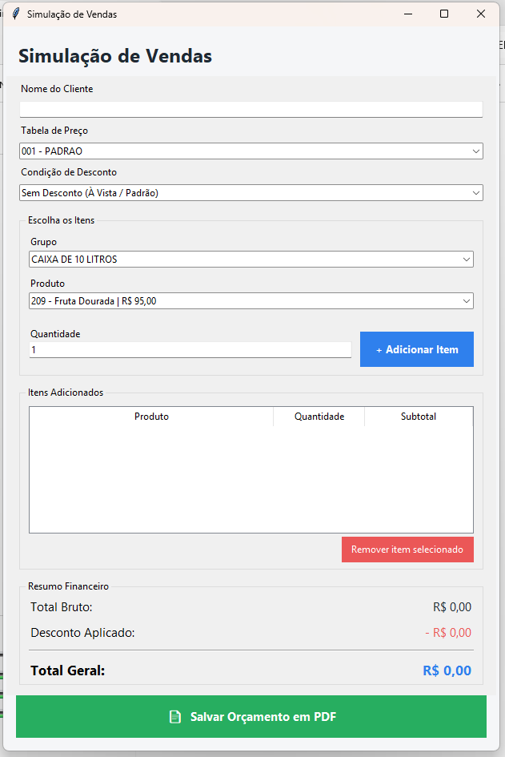

# Simulador de Vendas

Ferramenta criada para ajudar a equipe comercial a simular pedidos e mostrar
ao cliente, antes do fechamento, como ficaria a compra com as condições
oferecidas pela empresa.

Desenvolvido em 5 dias, a pedido da diretoria.

## Versões

### 1. Python (Tkinter)
Primeira versão, com interface gráfica desktop. Serviu para validar a lógica
de cálculo.
📁 `versao-python/`

### 2. HTML (versão final)
Migração para HTML para uso direto no navegador, publicada com
Google Apps Script (sem necessidade de domínio ou hospedagem paga).
📁 `versao-html/`

## Tecnologias
- Python / Tkinter
- HTML, CSS e JavaScript
- Google Apps Script

## Prints

## Como usar
- **Python:** instale o Python e execute `python simulador_pedido_final.py`
- **HTML:** abra o arquivo `simulador_pedido_final.html` no navegador

## Aviso
Os valores e condições exibidos nos prints são fictícios.

## Autor
Seu Nome - [LinkedIn](cole-o-link-do-seu-perfil)
